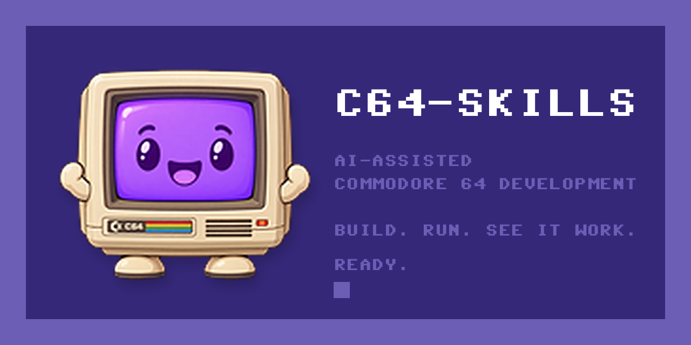
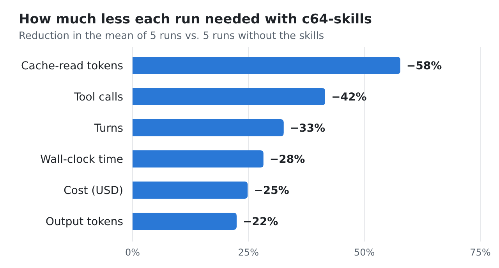
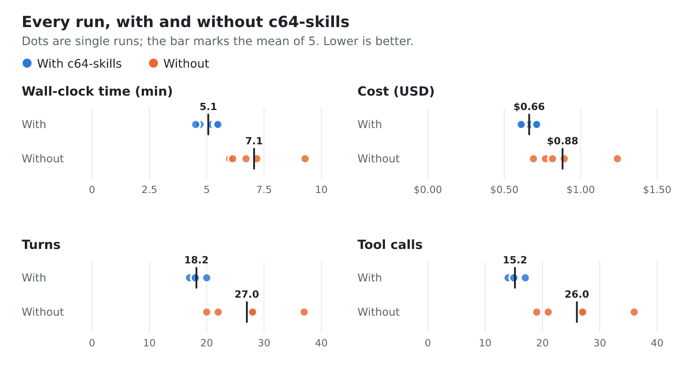

# c64-skills



**Your AI coding agent writes Commodore 64 assembly, runs it frame by frame to prove it works, then hands you a build you can play in the browser.**

c64-skills gives your AI coding agent the whole loop: write 6502 assembly, build it
with KickAssembler, run it in the [c64-ready](https://github.com/hayesmaker/c64-ready)
headless emulator, check what happened (the screen, memory, registers and
screenshots), and fix the code until it works. You get a tested program, not
something that "should work". The skills are standard `SKILL.md` Agent Skills, so they
work with Claude Code and any other tool that reads that format.

## Why c64-skills

Most C64 skill packs stop once the code is written. This one goes on to **prove the
program works**, using the [c64-ready](https://github.com/hayesmaker/c64-ready) emulator
and its agent CLI:

- **Nothing to install for the emulator.** No VICE, no emulator config. `npx` fetches
  c64-ready on first use, and it runs anywhere Node.js does.
- **Frame-exact, repeatable runs.** The agent says "run 300 frames, push the joystick
  right at frame 50, take a screenshot at frame 200", and gets the same result every
  time. A minute of C64 time runs in a few seconds.
- **Tests that read like intentions.** Stop at a label from your KickAssembler symbols,
  wait for text to appear, dump `score:3` by name, or fail the run if `ALL PASSED`
  never shows up.
- **A build you can play straight away.** When the agent is done, it gives you one
  command, `npx c64-ready build/main.prg --open`, which opens the program running in
  your browser with keyboard and gamepad controls.
- **KickAssembler throughout,** with a syntax guide aimed at the mistakes AI models
  actually make in it.

## Benchmarks

We gave Claude Code the same prompt 10 times: *"Make a single screen top-down racer
for the C64"*. Five runs had c64-skills installed and five didn't. With the skills,
the agent got there with **42% fewer tool calls, 33% fewer turns, 28% less time and
25% lower cost**. The slowest run with the skills still finished before the fastest
run without them.

<picture>
  <source media="(prefers-color-scheme: dark)" srcset="assets/bench/bench-savings-dark.png">
  
</picture>

| Mean of 5 runs | Without | With c64-skills | Change |
| -------------- | ------: | --------------: | -----: |
| Wall-clock time | 7.1 min | 5.1 min | **−28%** |
| API time | 6.5 min | 4.9 min | **−25%** |
| Turns | 27.0 | 18.2 | **−33%** |
| Tool calls | 26.0 | 15.2 | **−42%** |
| Cost | $0.88 | $0.66 | **−25%** |
| Output tokens | 49,276 | 38,216 | **−22%** |
| Cache-write tokens | 60,894 | 54,806 | **−10%** |
| Cache-read tokens | 1,452,383 | 613,603 | **−58%** |
| Runs that used the skills | 0 / 5 | 5 / 5 | |
| Runs that produced a `.prg` | 5 / 5 | 5 / 5 | |

<picture>
  <source media="(prefers-color-scheme: dark)" srcset="assets/bench/bench-runs-dark.png">
  
</picture>

<sub>Benchmarked 20 Nov 2026 with Claude Code 2.1.329 and `claude-sonnet-5-5`. The
two conditions were interleaved, and every run started from a clean home directory
and an empty project folder. The plugin was loaded only for the "with" runs. These
numbers measure how much work the agent needed, not how good the finished game was.</sub>

## Quick start

**1. Install the skills in your agent.** Pick whichever fits:

- **Any agent that reads `SKILL.md` skills:** the skills are plain folders. Clone this
  repository and copy (or symlink) `plugins/c64/skills/c64-ready` and
  `plugins/c64/skills/c64-asm` into the skills directory your agent reads. Check your
  tool's documentation for where that is.
- **Claude Code, as a plugin:** add this repository as a marketplace, then install the
  plugin. If the skills don't show up straight away, restart Claude Code.

  ```
  /plugin marketplace add hayesmaker/c64-skills
  /plugin install c64-skills@c64-skills
  ```

  To copy the folders instead (the first option), use `~/.claude/skills/` for all
  projects or `.claude/skills/` for a single project.

**2. Install the tools the skills use:**

| Tool | Needed for | Check |
| ---- | ---------- | ----- |
| [Node.js](https://nodejs.org/) 24+ | running programs in the emulator | `node -v` |
| Java 8+ | KickAssembler | `java -version` |
| [KickAssembler](https://theweb.dk/KickAssembler/) (`KickAss.jar`) | building `.asm` → `.prg` | see below |
| ffmpeg *(optional)* | recording video of a run | `ffmpeg -version` |

The emulator needs no separate install: the first run fetches
[`c64-ready`](https://www.npmjs.com/package/c64-ready) through `npx`.

KickAssembler is a free download. Unzip it anywhere, then either point at it:

```bash
export KICKASS_JAR=~/KickAssembler/KickAss.jar   # add to your shell profile
```

or put `KickAss.jar` in a `tools/` folder inside your project. The agent also looks
in `~/KickAssembler/` and `/opt/`.

**3. Ask for something.** You don't need to name the skills:

> Make a C64 program with a sprite I can move with the joystick.

> My raster split flickers on the left side. Find out why and fix it.

> Add a score counter at the top of the screen and show me a screenshot after
> I've collected three coins.

The agent builds the program, runs it for a few emulated seconds, presses joystick
buttons or keys if needed, and reads back the screen or memory. Along the way it will
usually show you screenshots.

## What's included

| Skill | What your agent can do with it |
| ----- | ------------------------------ |
| [**c64-ready**](plugins/c64/skills/c64-ready/SKILL.md) | Run `.prg`, `.d64`, `.crt` and `.c64` files, and drive them with scripted joystick and keyboard input. It can stop at a breakpoint or when text appears on screen, and read the screen, memory and registers. It also saves PNG screenshots, video and snapshots. Runs are repeatable: the same command gives the same result every time. |
| [**c64-asm**](plugins/c64/skills/c64-asm/SKILL.md) | Build with KickAssembler and report errors with line numbers. It comes with a tested starter project (raster interrupt, game loop and a joystick-controlled sprite), a KickAssembler syntax guide aimed at mistakes AI models commonly make, and a C64 hardware cheat sheet covering VIC-II, sprites, SID, CIA and KERNAL. |

## What a session looks like

> **You:** Make the sprite bounce off the screen edges.
>
> **Agent:** *edits `src/main.asm`, builds it, and runs it for 8 emulated seconds, dumping
> the sprite's direction variable and saving a screenshot every second. It sees the sprite
> turn around at X = 255 instead of at the right border, fixes the `$d010` (sprite X bit 8)
> handling, runs it again to confirm, and shows you the result.*

## Updating and removing

If you copied the skill folders, run `git pull` in your clone and copy them again
(symlinks update by themselves). Delete the two folders to remove them.

For the Claude Code plugin:

```
/plugin marketplace update c64-skills    # fetch the latest version of the listing
/plugin update c64-skills@c64-skills    # update the installed plugin
/plugin uninstall c64-skills@c64-skills
```

If you installed an early version under its old name, `c64`, run
`/plugin uninstall c64@c64-skills` and then install `c64-skills@c64-skills`.

## Using the tools yourself

The commands the agent runs work fine by hand. From a clone of this repository:

```bash
# start a project from the template and build it
mkdir -p mygame/src mygame/build
awk '/^```asm$/{f=1;next} /^```$/{f=0} f' plugins/c64/skills/c64-asm/templates/main-asm.md > mygame/src/main.asm
cd mygame
java -jar "$KICKASS_JAR" src/main.asm \
  -o "$PWD/build/main.prg" -odir "$PWD/build" -symbolfile -vicesymbols

# run it: push the joystick right for 30 frames, then show the screen and sprite position
npx -y -p c64-ready@3.3.1 c64-agent build/main.prg --symbols build/main.sym \
  --frames 60 --at 10:joy2=right --at 40:joy2=none --screen --dump 'd000:2' --screenshot shot.png
```

`c64-agent --help` lists every option, and the full reference is in
[plugins/c64/skills/c64-ready/reference/cli.md](plugins/c64/skills/c64-ready/reference/cli.md).
To play the program yourself, run `npx c64-ready build/main.prg --open`. The browser
player opens with it running, and reloading the page picks up a new build.

## Troubleshooting

- **The agent can't find KickAssembler:** set `KICKASS_JAR` to the full path of `KickAss.jar`, or put
  it in your project's `tools/` folder.
- **c64-ready fails to start:** check `node -v`. c64-ready needs Node.js 24 or newer.
- **The first run is slow:** `npx` is downloading c64-ready. Later runs start
  immediately. For an always-installed copy, run `npm install -g c64-ready`.
- **`npx c64-ready build/main.prg` opens a different game:** an old copy of c64-ready is
  installed globally and `npx` is running it. Update it with `npm install -g c64-ready@latest`,
  or remove it with `npm uninstall -g c64-ready`.
- **A small grey `lvllvl` mark in the middle of screenshots:** that's the emulator
  core's start-up watermark, not a bug in your program. c64-ready 3.3.1 and later keep
  it out of screenshots, so you'll only see it with an older global install. Update it
  with `npm install -g c64-ready@latest`.
- **Disk images (`.d64`) take a while to start:** the 1541 drive is emulated accurately,
  speed included. The agent knows to wait.

## Roadmap

Planned skills: C64 graphics (charsets, sprites and bitmaps with
[c64-pad](https://github.com/hayesmaker/c64-pad)), SID music, and
[c64-cheevos](https://github.com/hayesmaker/c64-cheevos) achievements. Ideas and issues
are welcome.

## Credits

- Emulation: [c64-ready](https://github.com/hayesmaker/c64-ready) (npm:
  [`c64-ready`](https://www.npmjs.com/package/c64-ready), with a hyphen; not the
  unrelated "c64ready" project), based on the c64.js core
  from [lvllvl](https://github.com/jaammees/lvllvl) by James.
- Mascot: **cbm-buddy**.
- Font in the banner: the freeware *Commodore 64* TrueType font by Devin Cook.

## License

MIT
