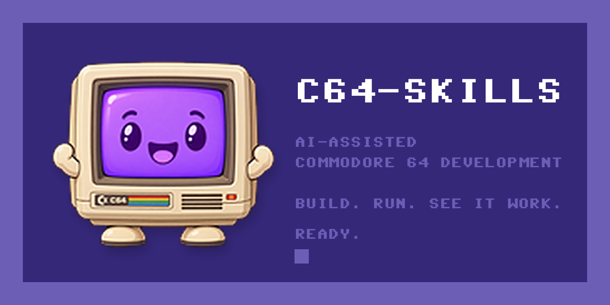

# c64-skills: Commodore 64 development skills

**Your AI coding agent writes Commodore 64 assembly, runs it frame by frame to prove it works, then hands you a build you can play in the browser.**

This plugin teaches Claude to write 6502 assembly, build it with KickAssembler, and run
the result in the [c64-ready](https://github.com/hayesmaker/c64-ready) headless
emulator. The agent then reads back what happened (the screen text, memory, CPU
registers and PNG screenshots) and fixes the code itself, instead of handing you
something that "should work". When it's done, it gives you one command that opens the
program in the c64-ready browser player so you can play it.

## Why this plugin

Plenty of skill packs teach an AI how to *write* 6502. This one is about **proving the
program works**, using the [c64-ready](https://github.com/hayesmaker/c64-ready) emulator
and its agent CLI:

- **Nothing to install for the emulator.** No VICE, no emulator config. `npx` fetches
  c64-ready on first use, and it runs anywhere Node.js does.
- **Frame-exact, repeatable runs.** The agent says "run 300 frames, push the joystick
  right at frame 50, take a screenshot at frame 200", and gets the same result every
  time. A minute of C64 time runs in a few seconds.
- **Tests that read like intentions.** Stop at a label from your KickAssembler symbols,
  wait for text to appear, dump `score:3` by name, or fail the run if `ALL PASSED`
  never shows up.
- **A build you can play straight away.** When the agent is done, it gives you one
  command, `npx c64-ready build/main.prg --open`, which opens the program running in
  your browser with keyboard and gamepad controls.
- **KickAssembler throughout,** with a syntax guide aimed at the mistakes AI models
  actually make in it.

## Skills

- **c64-ready:** run `.prg`, `.d64`, `.crt` and `.c64` files headlessly, and drive
  them with scripted joystick and keyboard input. It can stop at a breakpoint or when
  text appears on screen, dump memory, and save screenshots, video and snapshots. Runs
  are deterministic, so the same command gives the same result every time.
- **c64-asm:** a build → run → verify loop with KickAssembler that reports errors with
  line numbers. It includes a tested starter project (raster interrupt, game loop and a
  joystick-controlled sprite), a KickAssembler syntax guide, and a C64 hardware
  reference covering VIC-II, sprites, SID, CIA and KERNAL.

## Requirements

| Tool | Needed for |
| ---- | ---------- |
| [Node.js](https://nodejs.org/) 24+ | running programs in the emulator |
| Java 8+ and [KickAssembler](https://theweb.dk/KickAssembler/) (`KickAss.jar`) | building `.asm` → `.prg` |
| ffmpeg *(optional)* | recording video of a run |

Download KickAssembler yourself and point `KICKASS_JAR` at `KickAss.jar`, or put it in
your project's `tools/` folder. The plugin never downloads it.

## What the plugin runs and fetches

The plugin contains only instructions, reference notes and a starter assembly project (as Markdown). It
ships no scripts or programs. The skills tell Claude to run these commands:

- `java -jar KickAss.jar …` to build your source files, locally.
- `npx -y -p c64-ready@3.3.1 c64-agent …` to run the program in the c64-ready emulator.
  On first use this downloads that exact version of the
  [c64-ready package](https://www.npmjs.com/package/c64-ready) from the npm registry.
  If your project already has c64-ready installed, Claude uses that copy instead.
- The suggested `npx c64-ready <file> --open` command starts a local web server on
  `localhost` that serves the browser player and your built file, then opens it in
  your browser.

The only environment variables the skills read are `KICKASS_JAR` and `C64_READY_DIR`.
Both are optional file paths (to `KickAss.jar` and to a local c64-ready clone), not
credentials. The plugin sends no data anywhere, and the emulator runs entirely on your
machine.

## Example prompts

> Make a C64 program with a sprite I can move with the joystick.

> My raster split flickers on the left side. Find out why and fix it.

More documentation, troubleshooting and the source are at
[github.com/hayesmaker/c64-skills](https://github.com/hayesmaker/c64-skills).

## License

MIT
